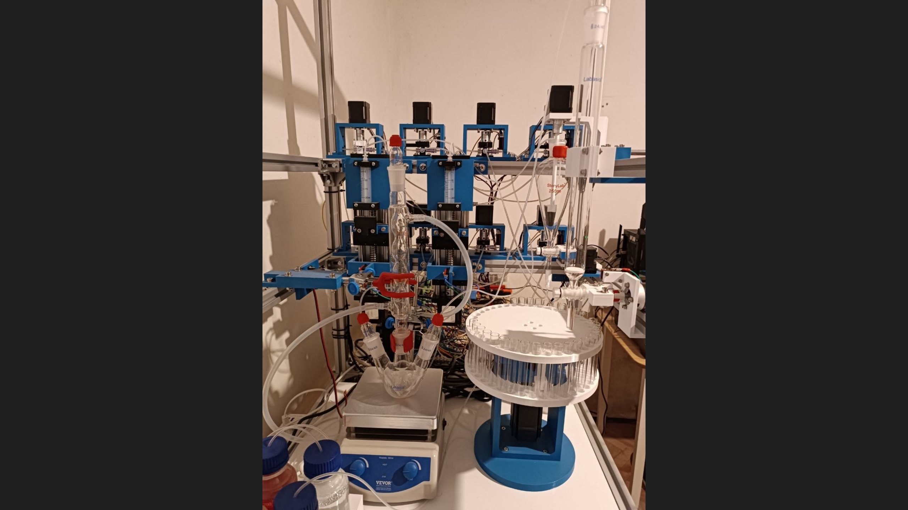

# SynMachine

An open-source mechatronics platform for exploring laboratory automation.



*The current SynMachine mechatronic prototype.*

SynMachine brings together mechanics, electronics, electrical wiring and power
systems, and software to execute programmed laboratory procedures. The aim is
to make these parts work together in a platform that can grow with new devices
and experimental workflows.

## The prototype today

The current prototype has been tested with colored liquids to observe transfers,
fluid paths and the execution of programmed procedures. This stage focuses on
mechatronic integration and workflow development.

The machine currently uses silicone tubing, medical-plastic valves and
medical-plastic syringes. The planned next material stage introduces PTFE tubing
and valves, together with glass syringes with PTFE plungers, to enable experiments
with actual reagents and solvents. Materials will be selected for the intended
chemistry.

## What you can do

Use **Recipes / Procedure Builder** to compose a procedure from supported
operations, save it, review it and run it again. Every save creates a new version;
each run keeps its own copy of the selected recipe.

Supported operations include:

- Add a specified volume from a bottle to the reactor.
- Wait for a specified time.
- Transfer liquid from the reactor to the separatory funnel (SF).
- Mix in the SF using the configured motor profile, then allow settling.
- Transfer liquid from the SF to the column.
- Collect fractions using timed collection and the carousel.

The interface also provides a machine schematic, animated active routes,
execution status and supervised service controls. Starting a procedure requires
a separate explicit action and fresh preparation confirmations.

Route animations follow backend commands; they do not measure liquid flow.
Volumes in the current demo profile are nominal command values.

## Try it without hardware

The fake-device profile lets you explore the interface and recipe workflow
without connecting an Arduino or servo.

You need Python 3.12 or newer and a Node.js version supported by Vite 8.
The current UI was verified with Node.js 24.

From the repository root, start the backend in one terminal:

```bash
cd backend
python3 -m venv .venv
.venv/bin/python -m pip install -e ".[dev]"
env -u LABFORGE_ARDUINO_PORT -u LABFORGE_SF_BOTTOM_VALVE_PORT \
  .venv/bin/python -m tests.browser_check \
  --state-dir /tmp/synmachine-browser-preview --port 8000
```

From the repository root, start the UI in a second terminal:

```bash
cd ui
npm ci
npm run dev -- --host 127.0.0.1 --port 5173 --strictPort
```

Open **http://127.0.0.1:5173/**. The backend terminal displays
`FAKE TRANSPORTS ONLY`, and the interface reports `Test devices`.
Keep this test state directory separate from real-machine state. An incompatible
existing state directory is refused rather than reset.

For operation with physical devices, see the separate
[live Recipes guide](backend/docs/LIVE_RECIPES.md). The current nominal live
profile has no configured automatic Recovery/Flush: a Stop or fault can leave
maintenance required and block another run.

## Inside the repository

| Directory | Purpose |
| --- | --- |
| [ui/](ui/README.md) | React interface, schematic, recipes and operator controls |
| [backend/](backend/README.md) | Python/FastAPI validation, storage, routing and orchestration |
| [firmware/](firmware/README.md) | Arduino Mega communication and low-level device control |
| [docs/](docs/README.md) | Architecture, development status and project records |
| [hardware/](hardware/README.md) | Space for future mechanical and electrical design files |

The UI handles interaction and visualization. The backend validates and
coordinates procedures. Firmware handles pins, motor movement, homing and
low-level execution. This separation provides a basis for adding devices and
operations as the project develops.

Some internal names still use `labforge`, including package names,
`LABFORGE_*` environment variables and the `LABFORGE/1` serial protocol.
SynMachine is the current project name. Earlier development history is preserved;
see the [migration record](docs/MIGRATION.md).

## Contributing

Contributions from engineers, chemists, researchers and interested makers are
welcome. Useful areas include mechanical design, electronics, software,
interface usability, documentation and reproducible test procedures.

For a substantial change, open an issue first to discuss the goal. For a pull
request, describe what changed and include the relevant checks or observations.
Please distinguish software test results from observations made on physical
hardware. Contributions are submitted under the project's Apache 2.0 license
unless explicitly stated otherwise.

### Development checks

Run the relevant commands from each component directory:

```bash
# ui/
npm test
npm run lint
npm run build

# backend/ with its virtual environment activated
python -m pytest -q
ruff check .

# firmware/ with PlatformIO installed
pio test -e native
pio run -e megaatmega2560
```

The firmware command above builds the firmware; it does not upload it.
Component documentation contains additional setup and verification details.

## License

The original project software and accompanying documentation are licensed under
the **Apache License, Version 2.0**. See [LICENSE](LICENSE) and [NOTICE](NOTICE).
Third-party dependencies and any third-party material retain their own license
terms. See the [dependency license inventory](docs/THIRD_PARTY_NOTICES.md).
